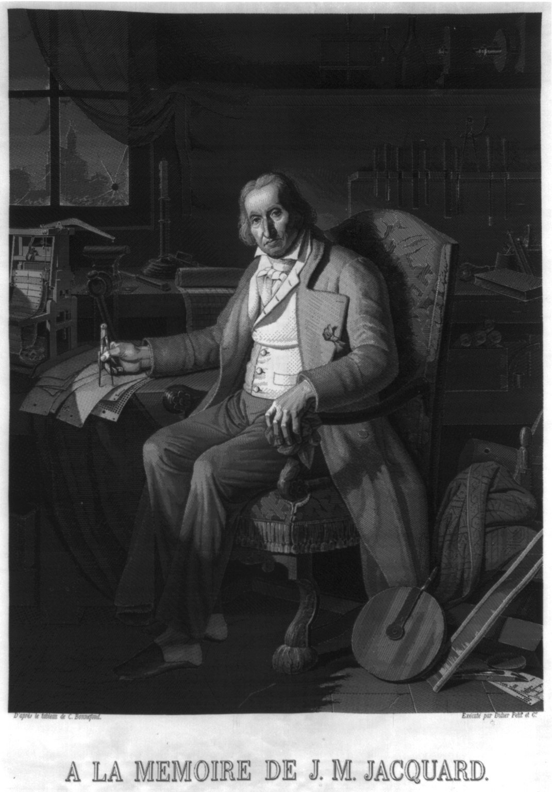
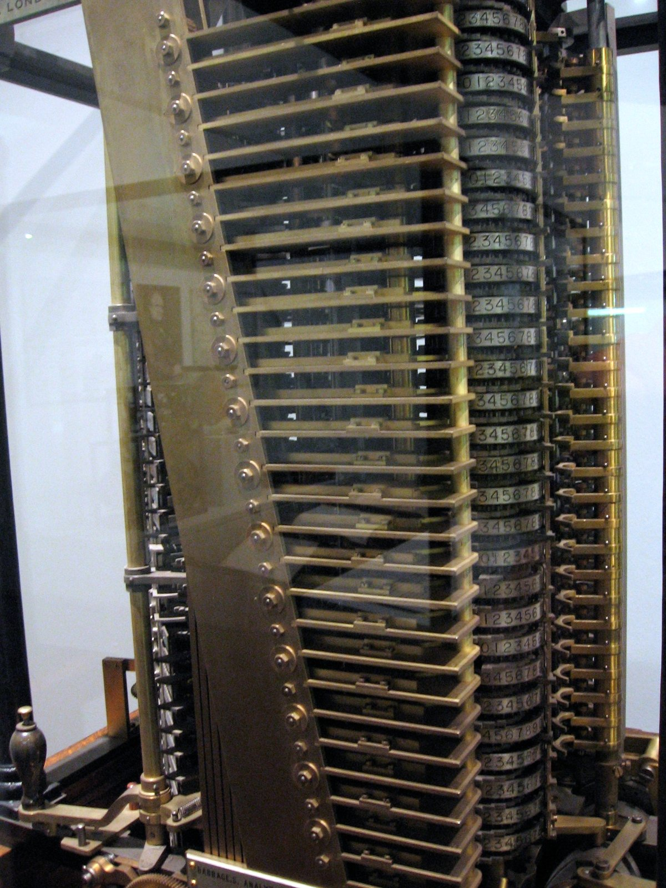
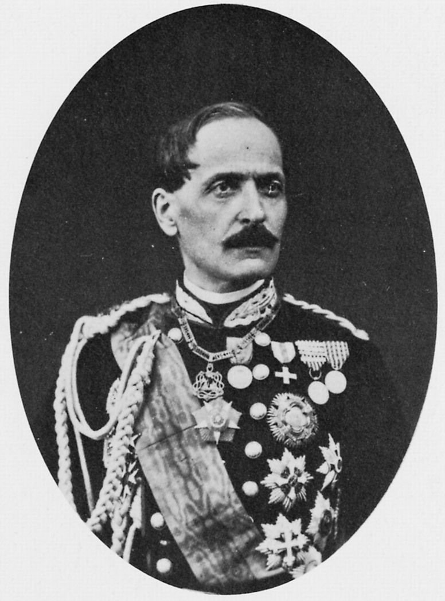
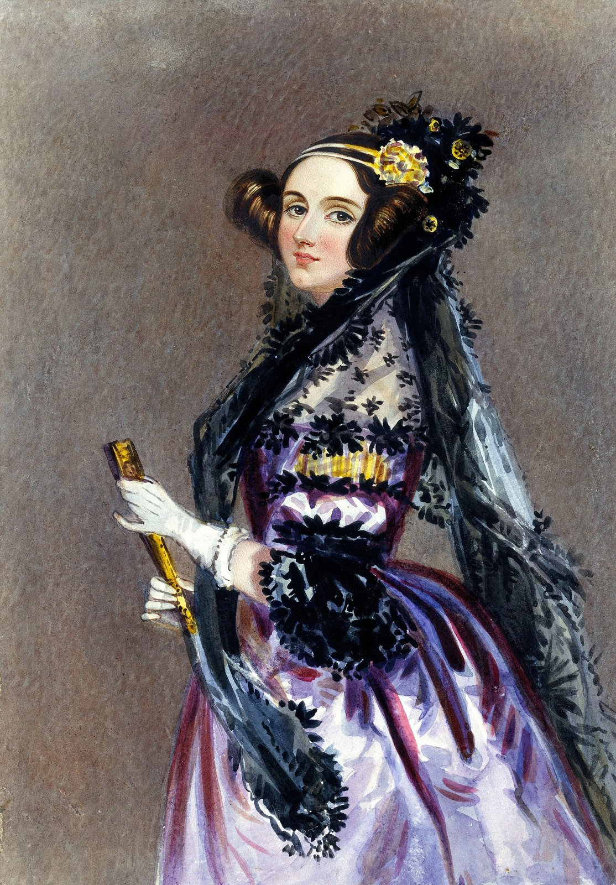
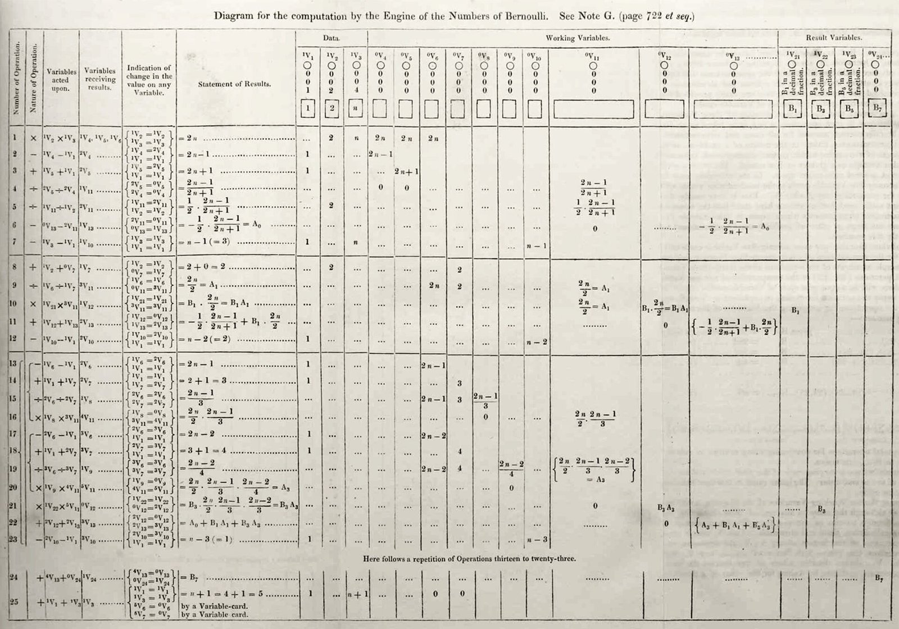
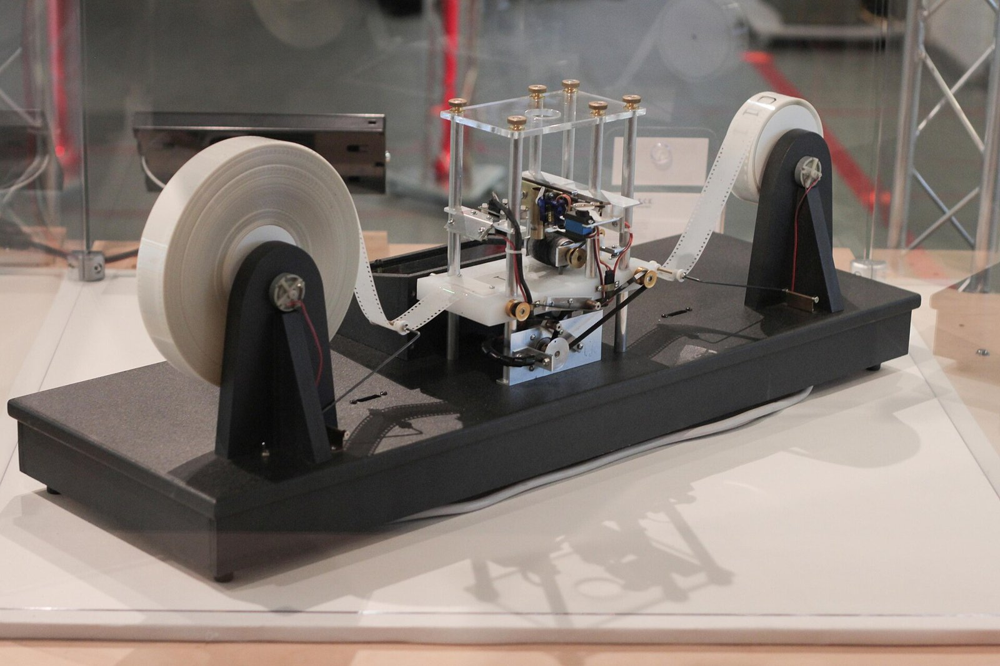
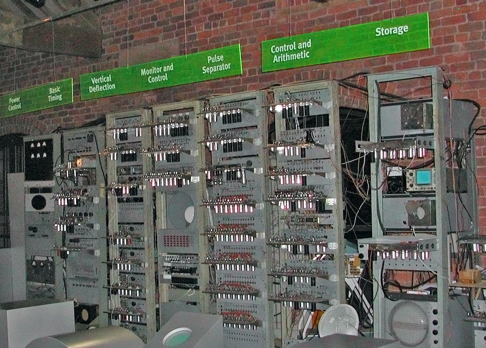
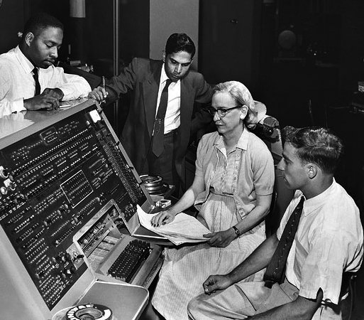
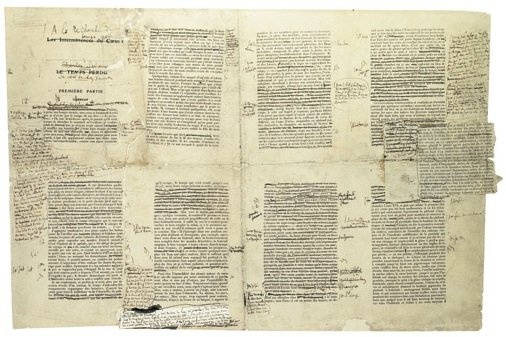

# Il codice è un testo

Elementi di Informatica per il Design
ISIA di Urbino · 2026/2027

---

## Oggi

1. Che cos'è un programma
2. Visual Studio Code
3. Il primo codice

---

## Comunicazione di servizio

Ho pubblicato un _repository_ per il corso su GitHub e dentro ci sono anche le diapositive delle lezioni.

☢️ no panic: parleremo ancora di GitHub

---

## La settimana scorsa

Durante l'esercitazione:
- una persona ha **scritto il programma** (era il programmatore/la programmatrice)
- il foglio/messaggio scritto a mano o digitalmente **era il programma**
- l'altra persona ha **eseguito il programma**

Ne consegue che il modo in cui il programma è scritto incide sul risultato finale

---

# Che cos'è un programma

---

## Il telaio Jacquard


Un foro: il filo si alza. Pieno: il filo resta fermo.
https://www.youtube.com/watch?v=J49TTfG3H8w
*Foto: Stephencdickson, CC BY-SA 4.0*

---

## Lione, 1839



Un ritratto di Jacquard tessuto in seta
**circa 24.000 schede**
*Library of Congress, pubblico dominio*

---

## Il disegno non sta nella macchina

**Sta nelle schede** e quello è il programma

---

## La macchina analitica



Charles Babbage, dagli anni Trenta dell'Ottocento
*Foto: Marcin Wichary, CC BY 2.0*

---

## Torino, 1840



Luigi Federico Menabrea ascolta Babbage e ne scrive un resoconto

---

## Ada Lovelace, 1843



«La macchina analitica tesse motivi algebrici proprio come il telaio Jacquard tesse fiori e foglie»

---

## La nota G



Le operazioni che la macchina avrebbe dovuto eseguire, una dopo l'altra

---

## Non solo numeri

La macchina «potrebbe comporre brani musicali di qualunque complessità ed estensione»

Ada Lovelace, nota A

---

## Alan Turing, 1936



**Una macchina, molti programmi**, la macchina di Turing 
(a 24 anni!) Turing immagina che il nastro con il programma stia _dentro_ alla macchina e non più fuori, come nel telaio di Jacquard
https://it.wikipedia.org/wiki/Macchina_di_Turing
*Modello costruito da Mike Davey · Foto: Rocky Acosta, CC BY 3.0*

---

## Manchester, 21 giugno 1948



Fino a quel momento, per cambiare il lavoro di un calcolatore spesso bisognava cambiare cavi e interruttori. Da qui in avanti, il programma è un **dato** come gli altri, conservato nella macchina stessa. Si può salvare, copiare, correggere. In una parola: **il programma diventa un testo.**
*La replica del Baby al Science and Industry Museum*

---

## Il codice è un testo

Scritto da qualcuno per essere letto da una macchina **e da altre persone**

---

## Grace Hopper



Dai numeri alle parole, prime forme di programmazione
Secondo lei **un linguaggio di programmazione è scritto per le persone**, non per la macchina. La macchina capirebbe benissimo i numeri. Immagina quindi linguaggi più facili per l'essere umano.
*Con il suo gruppo, al lavoro su UNIVAC, giugno 1957 · Smithsonian Institution, CC BY 2.0*

---

## Il redattore marca il testo



Le bozze di *Dalla parte di Swann*, corrette da Marcel Proust
Dal lavoro di editing viene il concetto di _markup_, che è appunto il codice che useremo anche noi: "qui metti un corsivo", "qui aggiungi un grassetto", etc...

---

## «Questo è un titolo»

```html
<h1>Oggi c'è il sole</h1>
```

Nel 1969, all'IBM, tre ingegneri inventano il GML (Generalized Markup Language), un modo di scrivere questi segni _markup_ dentro il testo, per il computer. 

L'idea importante è questa: invece di dire "questa riga va in corpo 18 neretto", si dice "questo è un titolo". Come appare un titolo lo si decide da un'altra parte. 

Da qui nasce SGML (Standard Generalized Markup Language), che diventa uno standard internazionale nel 1986. E da SGML, all'inizio degli anni Novanta, Tim Berners-Lee ricava l'HTML, il linguaggio delle pagine web.

---

## Sol LeWitt, 1967

[Immagine: lewitt-wall-drawing-831.jpg, su Wikimedia Commons](https://commons.wikimedia.org/wiki/File:Bilbao_-_Museo_Guggenheim_-_Wall_Drawing_831_(Geometric_Forms),_de_Sol_LeWitt_6.JPG)

«L'idea diventa una macchina che fa l'arte»
https://youtu.be/M8swNRqrfuY?si=yH2eKz1YljHmO37C&t=353
*Wall Drawing 831, Guggenheim Bilbao · Foto: Zarateman, CC0*

---

## Karl Gerstner, 1964

*Programme entwerfen*, Progettare programmi

«Invece di soluzioni per problemi, **programmi per soluzioni**»

Gerstner non pensa solo ai computer. Pensa a un modo di progettare: invece di disegnare un logo, un'impaginazione, un carattere, si progetta il **sistema di regole che li genera**, e da cui escono **molte soluzioni possibili**.

---

## Si progetta la regola

**e la regola genera la forma**

---

## Processing e p5.js

**2001** · Processing, Casey Reas e Ben Fry
**2013** · p5.js, Lauren Lee McCarthy
**2025** · p5.js 2, quella che usiamo noi

Un programma è uno *sketch*

---

## Lovelace e Turing

«La macchina analitica non ha alcuna pretesa di originare alcunché. Può fare qualunque cosa noi sappiamo ordinarle di eseguire.» · Lovelace, 1843

Nel 1950 Alan Turing, in un articolo diventato famoso, risponde proprio a questa frase, e la chiama "l'obiezione di Lady Lovelace". Turing osserva che le macchine lo sorprendono spesso, e nella parte finale dello stesso articolo immagina **macchine che imparano, invece di ricevere tutte le regole già scritte**.

---

## Due modi di avere regole

| Regole scritte | Regole apprese |
|---|---|
| dal telaio a p5.js | Gemini e gli altri modelli linguistici |
| qualcuno le scrive, una per una | ricavate da moltissimi esempi |
| fanno quello che diciamo | possono sorprenderci, e sbagliare |

---

# Visual Studio Code

---

## Tre cose oggi

1. Aprire una cartella
2. Scrivere in un file
3. Salvare

---

## 1 · Il primo avvio

**Applicazioni** → **Visual Studio Code**

Al primo avviso del Mac: **Apri**

---

## 2 · Spegniamo l'assistente

Aprite le Impostazioni
Cercate `chat.disableAIFeatures` e spuntate la casella

---

## 3 · La cartella del corso

Nel Finder, una cartella senza spazi né accenti
Tipo "rachiele" o quello che vi pare
	e poi "esercizi"

---

## 4 · Aprite la cartella

**File → Open Folder…**
(sul Mac può chiamarsi **Open…**)

Alla domanda sugli autori: **Yes, I trust the authors**

**Controllo:** a sinistra vedete la cartella e le sottocartelle

---

## 5 · Il codice è testo

1. In `esercizi` create `prova.txt` e scrivete una frase
2. Rinominatelo `prova.html` e apritelo nel browser
3. Scrivete `<h1>` prima della frase e `</h1>` dopo. Salvate e ricaricate

**Controllo:** la frase diventa un titolo

---

## Il pallino

Un **pallino bianco** sulla scheda del file:
le modifiche non sono salvate

`Cmd + S`

Il browser vede solo quello che avete salvato

<small>Windows: Ctrl + S</small>

---

# Il primo codice

---

## L'editor online di p5.js

**shorturl.at/jARZ5**

p5.js ha un suo editor nel browser, ma noi useremo sempre Visual Studio Code

---

## La stessa griglia, nella vostra cartella

1. Scaricate da Classroom `L02-griglia-di-cerchi` e dezippatela
2. Mettetela nella cartella `esercizi`
3. In Visual Studio Code aprite `sketch.js`
4. Nel browser aprite `index.html`

---

## Salvare, ricaricare

Visual Studio Code: `Cmd + S`
Browser: `Cmd + R`

Sempre in quest'ordine

<small>Windows: Ctrl + S, poi Ctrl + R</small>

---

## Prima prevedere, poi provare

```js
let colonne = 8;
let diametro = 40;
let distanza = 60;
```

Che cosa succede se scrivo **20** al posto di **8**?

---

## Quattrocento cerchi

Quante volte compare la parola "cerchio" nel codice?

---

## Per lunedì prossimo, 2 novembre

1. Annotate la vostra griglia preferita: tre numeri nello sketch
