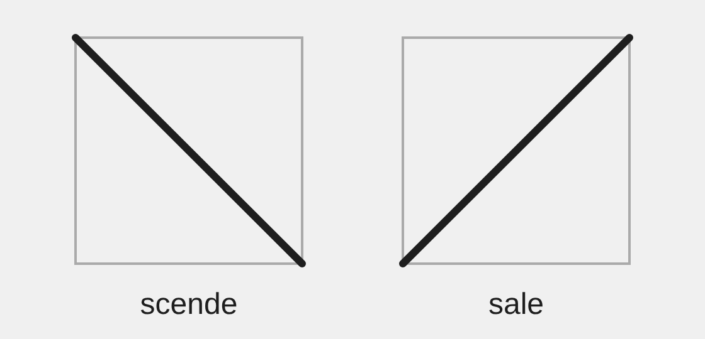

# Una regola, cento forme

Elementi di Informatica per il Design
ISIA di Urbino · 2026/2027

---

## Oggi

Oggi è l'ultima lezione del precorso. Riprendiamo il dado, impariamo a dare un nome a una regola, e con quella regola costruiamo un labirinto. Poi guardiamo i vostri lavori, e alla fine vediamo dove porta tutto questo.

1. La cartella della L06
2. Il dado
3. La funzione
4. Il labirinto
5. La copertina di un compagno
6. Le vostre copertine
7. Che cosa sapete fare
8. Dove andiamo

---

## Prima di iniziare

Nella griglia della L05, se scrivete fill() dopo la forma, alcune forme prendono il colore sbagliato. Vediamo perché.

### Rimettere in ordine i rientri

Fate clic nel codice e premete `Maiusc + Opt + F`. Oppure aprite la palette dei comandi, `Cmd + Maiusc + P`, e scegliete **Format Document**.

<small>Windows: Maiusc + Alt + F, oppure Ctrl + Maiusc + P</small>

---

## La cartella della L06

Come nella L05, un solo file su Classroom, da estrarre dentro `esercizi`.

1. Scaricate `L06-una-regola-cento-forme.zip` e spostatelo dentro `esercizi`
2. Fate doppio clic: compare la cartella della lezione. Lo zip si può cestinare

<small>Windows: clic destro → Estrai tutto, e cancellate l'ultimo \L06-una-regola-cento-forme dal percorso</small>

---

## Com'è fatta adesso

```
esercizi/
├── L04-ripetere/
├── L05-il-caso-e-la-scelta/
└── L06-una-regola-cento-forme/
    ├── 1-dado/
    ├── 2-croci/
    ├── 3-labirinto/
    └── 4-archi/
```

Le cartelle sono numerate nell'ordine in cui le usiamo oggi. `4-archi` è per chi va avanti.

---

## La prima copertina del corso

Da oggi, a ogni lezione, la copertina del nostro corso su Classroom è lo sketch di uno di voi.

Guardate Classroom: la prima è già lì.

---

# Il dado

Ripartiamo da dove si era fermata la L05

---

## Un dado per ogni cella

Nella L05 la griglia sceglieva con una regola fissa: le prime quattro colonne disegnavano un quadrato, le altre un cerchio. Ogni volta che ricaricate la pagina, il disegno resta lo stesso.

Oggi vogliamo che a scegliere sia il caso: in ogni cella tiriamo un dado, e il dado decide se disegnare un quadrato o un cerchio.

Aprite `1-dado`: c'è la griglia della L05, con la regola fissa già scritta.

---

## Che numero esce da `random()`

Nella L05 avete scritto `random(100, 500)`, che dà un numero a caso tra 100 e 500. Quando invece scrivete `random()` con le parentesi vuote, il computer sceglie a caso un numero tra 0 e 1.

Tra 0 e 1 non ci sono numeri interi, quindi escono numeri con la virgola, come questi:

`0.27` · `0.81` · `0.04` · `0.56` · `0.39`

Ogni volta che il computer legge `random()`, esce un numero nuovo. Il numero non arriva mai a 1.

<small>Nel codice la virgola si scrive con il punto: `0.27`, non `0,27`</small>

---

## Una domanda al numero

Il numero da solo non decide niente. Per scegliere la forma, gli facciamo una domanda con `if`: il numero è più piccolo di `0.5`? Se la risposta è sì, disegniamo un quadrato. Se è no, un cerchio.

Al posto della riga `if (colonna < 4) {` scrivete queste due righe:

```js
let dado = random();
if (dado < 0.5) {
```

La prima riga tira il dado e mette il numero uscito nella variabile `dado`. La seconda fa la domanda. Il resto, `square`, `else` e `circle`, rimane com'è.

---

## Prima prevedere

📝 **Sul foglio**, prima di salvare

Su 64 celle, quanti quadrati vi aspettate? Scrivete un numero.

Se ricaricate la pagina, i quadrati restano negli stessi posti?

---

## Perché metà e metà

`0.5` sta esattamente a metà strada tra 0 e 1.

```
0 ─────────────── 0.5 ─────────────── 1
    sì: quadrato         no: cerchio
```

`random()` non preferisce nessun numero: può cadere in qualunque punto della linea, con la stessa probabilità. La parte a sinistra di `0.5` è metà della linea, quindi il numero ci cade più o meno una volta su due. È come lanciare una moneta: testa quadrato, croce cerchio.

Su 64 celle, allora, i quadrati sono circa 32. Non esattamente 32, perché il caso non tiene i conti: a volte ne escono 29, a volte 35.

---

## Un lancio per ogni cella

La riga `let dado = random();` sta dentro i due cicli. Quindi il computer la legge una volta per ogni cella: 64 celle, 64 lanci, 64 numeri diversi. Per questo ogni cella sceglie da sola, senza guardare le altre.

Per vedere i 64 numeri, sotto `let dado = random();` aggiungete questa riga:

```js
console.log(dado);
```

Poi aprite la console di Chrome con `Cmd + Opt + J`. Ogni riga della console è un lancio.

---

## E con `0.2`?

📝 **Sul foglio**, prima di salvare

Disegnate la linea da 0 a 1 e segnate dove cade `0.2`. Colorate la parte del sì, quella a sinistra.

Adesso cambiate `0.5` in `0.2`. Quanti quadrati vi aspettate, su 64?

---

# La funzione

Come si dà un nome a una regola

---

## Le funzioni che usate già

Da tre settimane usate delle funzioni, anche se non le abbiamo mai chiamate così.

`circle(300, 300, 100)` è una funzione. Dentro p5.js qualcuno ha scritto tutte le istruzioni che servono per disegnare un cerchio, e le ha raccolte sotto un nome: `circle`. Voi scrivete solo il nome e, tra le parentesi, i valori: dove disegnare il cerchio e quanto grande.

Anche `fill`, `line`, `random` e `createCanvas` sono funzioni. Oggi ne scrivete una vostra.

---

## Dentro `circle`

Le istruzioni di `circle` si possono leggere, perché il codice di p5.js è aperto a tutti. Dalla Reference, in fondo alla pagina di `circle`, il link `src/shape/2d_primitives.js` porta qui:

```js
fn.circle = function (...args) {
    const argss = args.slice(0, 2);
    argss.push(args[2], args[2]);
    return this._renderEllipse(...argss);
};
```

`fn.circle = function` vuol dire: la funzione che si chiama `circle` è fatta così. È un modo di scrivere diverso dal nostro, ma la sostanza è la stessa. Non serve capire ogni parola: nella prossima diapositiva seguiamo solo che cosa succede ai valori.

<small>[Il codice di `circle` su GitHub](https://github.com/processing/p5.js/blob/v2.4.0/src/shape/2d_primitives.js#L469), senza la riga di commento</small>

---

## Che cosa fa `circle`

1. riceve i tre valori che scrivete voi: `x`, `y` e il diametro
2. tiene i primi due, `x` e `y`
3. aggiunge due volte il diametro: una volta come larghezza, una volta come altezza
4. passa i quattro valori alla funzione che disegna le ellissi

Per p5.js, quindi, un cerchio è un'ellisse larga e alta uguale. E una funzione può chiamarne un'altra: oggi lo farete anche voi.

---

## Come uno stile di paragrafo

In InDesign uno stile di paragrafo raccoglie molte scelte sotto un nome solo: il carattere, il corpo, l'interlinea, il colore. Lo applicate a cento paragrafi, e se cambiate lo stile cambiano tutti e cento.

Una funzione fa lo stesso con le istruzioni. Le raccoglie sotto un nome, e voi le usate tutte le volte che servono. Se cambiate le istruzioni dentro la funzione, il disegno cambia in tutti i punti in cui l'avete usata.

---

## Come si scrive una funzione

Aprite `2-croci`. In fondo al file c'è una funzione già scritta:

```js
function croce(x, y) {
    line(x - 20, y, x + 20, y);
    line(x, y - 20, x, y + 20);
}
```

- `function` dice al computer che qui comincia una funzione
- `croce` è il nome, scelto da chi l'ha scritta (voi)
- tra le parentesi tonde ci sono `x` e `y`: i valori che la funzione riceve, cioè il centro della croce
- tra le graffe ci sono le istruzioni: le due linee della croce

---

## Scrivere non è disegnare

Una funzione scritta da sola non disegna niente. È come preparare uno stile di paragrafo senza applicarlo a nessun paragrafo.

Per disegnare, la funzione va **chiamata**: si scrive il suo nome, con i valori tra le parentesi. In `setup()` ci sono tre chiamate:

```js
croce(100, 100);
croce(300, 200);
croce(500, 100);
```

---

## Che cosa succede in una chiamata

Quando il computer legge `croce(300, 200);`, salta alla funzione `croce`. Lì mette 300 al posto di `x` e 200 al posto di `y`, poi esegue le due righe, una dopo l'altra:

```js
line(300 - 20, 200, 300 + 20, 200);   // cioè line(280, 200, 320, 200)
line(300, 200 - 20, 300, 200 + 20);   // cioè line(300, 180, 300, 220)
```

Quando ha finito, torna indietro e passa alla riga dopo la chiamata.

---

## Prima prevedere

📝 **Sul foglio**, prima di aprire lo sketch

Sul vostro foglio di carta disegnate un quadrato, grande quanto volete: rappresenta lo sketch, che misura 600 × 600 pixel. Dividete ogni lato in sei parti uguali: ogni parte vale 100 pixel. Poi segnate dove compaiono le tre croci.

Poi aprite `index.html` con Live Server, e controllate.

---

## Dove si scrive

La funzione si scrive fuori da `setup()`, sotto la sua graffa di chiusura: è una regola a sé, e `setup()` la usa. Le chiamate invece stanno dentro `setup()`, perché è lì che il computer esegue le istruzioni, all'avvio.

```js
function setup() {
    croce(100, 100);    // qui si chiama
}

function croce(x, y) {  // qui si scrive
    line(x - 20, y, x + 20, y);
    line(x, y - 20, x, y + 20);
}
```

Anche `setup` è una funzione: la scrivete voi, e la chiama p5.js quando la pagina si apre.

---

## Provate

Aggiungete in `setup()` altre due chiamate a `croce`, con valori scelti da voi.

Poi, dentro la funzione, cambiate i quattro `20` in `40`, e salvate. Che cosa succede alle croci? Perché cambiano tutte insieme?

---

## La funzione dentro il ciclo

Una chiamata si può mettere anche dentro un ciclo. In `setup()`, sotto le chiamate, scrivete:

```js
for (let colonna = 0; colonna < 5; colonna++) {
    croce(60 + colonna * 120, 400);
}
```

Il ciclo fa cinque giri. A ogni giro chiama `croce` con una `x` diversa: 60, 180, 300, 420, 540. La `y` resta sempre 400. Nello sketch compaiono cinque croci in fila.

---

# Il labirinto

Una regola per una cella, ripetuta in tutta la griglia

---

## Due modi di attraversare una cella

Prendete una cella quadrata. Con una linea dritta da un angolo all'angolo opposto, la potete attraversare in due modi soli:



- la diagonale che **scende** va dall'angolo in alto a sinistra a quello in basso a destra
- la diagonale che **sale** va dall'angolo in basso a sinistra a quello in alto a destra

Oggi, in ogni cella, il computer tira il dado e sceglie una delle due.

---

## Prima prevedere

📝 **Sul foglio**

Disegnate una griglia di 4 × 4 celle. In ogni cella fate scegliere al caso: lanciate una moneta, oppure chiedete al compagno «testa o croce?». Testa, la diagonale che scende; croce, quella che sale.

Guardate il vostro foglio di carta: si vede già un disegno? Che cosa vi aspettate con 144 celle, 12 per lato?

---

## Gli angoli della cella

📝 **Sul foglio**: disegnate una cella grande e scrivete accanto ai quattro angoli le loro coordinate

In questa griglia `x` e `y` sono l'angolo in alto a sinistra della cella, non il centro come per i cerchi. Per le linee è più comodo, perché vanno da un angolo all'altro.

Gli altri tre angoli si trovano sommando il lato: andando verso destra lo si somma alla `x`, andando verso il basso lo si somma alla `y`.

```
(x, y) ──────────────── (x + lato, y)
   │                          │
   │                          │
(x, y + lato) ───── (x + lato, y + lato)
```

---

## La griglia è già pronta

Aprite `3-labirinto`. In cima c'è `lato`, il lato di una cella: 50 pixel. Lo sketch è largo 600 pixel, e 600 diviso 50 fa 12: dodici colonne e dodici righe.

Nei due cicli, come nella L04, per ogni riga si disegnano tutte le colonne. Ma in ogni casella, al posto di `circle`, la griglia chiama una funzione:

```js
let x = colonna * lato;
let y = riga * lato;
cella(x, y);
```

La colonna 0 comincia a 0, la colonna 1 a 50, la colonna 2 a 100: ogni colonna sta un lato più a destra della precedente. In fondo al file c'è la funzione `cella`, ancora vuota.

---

## La regola della cella

Dentro la funzione `cella`, al posto del commento, scrivete la regola: il computer tira il dado, e il dado sceglie la diagonale.

```js
let dado = random();
if (dado < 0.5) {
    line(x, y, x + lato, y + lato);
} else {
    line(x, y + lato, x + lato, y);
}
```

La prima linea va dall'angolo in alto a sinistra, `(x, y)`, a quello in basso a destra: scende. La seconda va dall'angolo in basso a sinistra, `(x, y + lato)`, a quello in alto a destra: sale.

Salvate.

---

## Nessuno l'ha disegnato

Nello sketch è comparso un labirinto, ma nessuno l'ha disegnato. Ogni cella ha fatto una sola scelta, a caso, senza guardare le celle vicine: il labirinto nasce dall'insieme delle 144 scelte.

Ricaricate la pagina: ogni volta esce un labirinto diverso, con la stessa regola. È già l'idea del vostro libro: una regola, molte copie.

---

## Più fitto

Cambiate `lato` da 50 a 20, e poi a 10. Salvate ogni volta.

La funzione `cella` non cambia. Cambia solo il valore di `lato`, che la griglia e la cella usano tutte e due. Con `lato` uguale a 10, le colonne sono 60 e le righe 60: le celle diventano 3600, e le scelte anche.

---

## Cambiate la regola, non la griglia

La griglia chiama `cella` in ogni casella, ma non sa che cosa c'è dentro. Quindi, se cambiate le istruzioni dentro `cella`, cambia tutto il disegno, e la griglia resta com'è. È lo stile di paragrafo: si cambia in un punto, e cambia ovunque.

Provate:
- lo spessore delle linee, con `strokeWeight` in `setup()`
- due colori: prima di ciascuna `line`, uno `stroke` diverso
- uno sfondo diverso, con `background`

---

# Che cosa sapete fare

---

## Cinque parole

Nel precorso avete imparato cinque parole del codice. Sono le stesse con cui farete il libro.

| Parola | Che cosa fa | Nel libro, per esempio |
|---|---|---|
| variabile, `let` | dà un nome a un numero, così lo cambiate in un punto solo | i margini, il corpo del testo |
| ciclo, `for` | ripete un'istruzione senza riscriverla | le pagine, le righe |
| caso, `random` | fa una scelta diversa a ogni copia | ogni copia stampata è diversa |
| condizione, `if` | sceglie tra due strade | le pagine pari e quelle dispari |
| funzione, `function` | dà un nome a una regola | la regola di una pagina, usata per tutte le pagine |

---

# Chi l'ha fatto prima di voi

---

## Georg Nees, *Schotter*

Georg Nees è stato tra i primi a esporre immagini fatte con un computer: nel febbraio 1965, a Stoccarda. Tra il 1968 e il 1970 ha fatto *Schotter*, che in tedesco vuol dire «ghiaia».

*Schotter* è una griglia di quadrati, come le vostre. In alto i quadrati sono in ordine. Più si scende, più il caso li sposta e li ruota, finché sembrano un mucchio di sassi.

[La scheda del Victoria and Albert Museum](https://collections.vam.ac.uk/item/O221321/schotter-print-nees-georg/)

---

## Il codice di *Schotter*

Nees scriveva in ALGOL, uno dei linguaggi di programmazione di allora. In ALGOL le parole del linguaggio stanno tra apici: `'FOR'`, `'BEGIN'`, `'END'`. Questo è il ciclo che disegna i quattro lati di un quadrato:

```
'FOR' S:= 1 'STEP' 1 'UNTIL' 4 'DO'
'BEGIN' PSI := PSI + PIHALB;
LINE(P1 + R*cos(PSI),Q1 + R*sin(PSI))
'END';
```

<small>[Una parte del codice, nel Database of Digital Art](http://dada.compart-bremen.de/item/algorithm/1)</small>

---

## Vera Molnár, *Interruptions à recouvrements*, 1969

[Immagine: molnar-interruptions-a-recouvrements.jpg, su Wikimedia Commons](https://commons.wikimedia.org/wiki/File:Vera_Molnar._Interruptions_%C3%A0_recouvrements_from_1969.jpg)

Vera Molnár era ungherese e ha lavorato a Parigi. Dal 1959, prima ancora di poter usare un computer, eseguiva a mano regole come le vostre: lo chiamava *machine imaginaire*, la macchina immaginaria. Nel 1968 ha potuto usare un computer, in un laboratorio universitario di Parigi.

In *Interruptions* parte da una griglia di linee tutte uguali, e ruota ognuna a caso. Poi cancella a caso dei pezzi, e restano dei vuoti.

*Anne and Michael Spalter Digital Art Collection, CC0*

---

## Il labirinto, nel 1982

Nel 1982 il manuale del Commodore 64, un computer di casa di quegli anni, conteneva un programma che funziona come il vostro labirinto: riempie lo schermo di diagonali scelte a caso. Nella forma più famosa sta in una riga sola:

```
10 PRINT CHR$(205.5+RND(1)); : GOTO 10
```

`PRINT` scrive un carattere sullo schermo. `GOTO 10` torna all'inizio della riga, quindi il programma si ripete senza fine, un carattere dopo l'altro.

---

## Come si legge la riga

`RND(1)` è il nostro `random()`: un numero a caso tra 0 e 1. Sommato a 205.5, dà un numero tra 205.5 e 206.5.

`CHR$` tiene solo la parte intera del numero: quindi esce 205 oppure 206, una volta su due ciascuno. Sul Commodore 64, 205 e 206 sono i due caratteri diagonali, `╲` e `╱`.

È il vostro `dado < 0.5`, scritto in un altro modo. Nel 2012 dieci studiosi hanno dedicato a questa riga un libro intero, pubblicato da MIT Press. Si scarica gratis da [10print.org](https://10print.org/).

---

## Le piastrelle di Truchet, 1704

Ancora prima dei computer, nel 1704, un frate domenicano, Sébastien Truchet, pubblicò nelle memorie dell'Accademia Reale delle Scienze di Parigi uno studio su piastrelle quadrate divise in diagonale in due triangoli, uno nero e uno bianco. Studiava in quanti modi si possono accostare.

Le piastrelle con i quarti di cerchio, come quelle di `4-archi`, portano ancora il suo nome: oggi si chiamano piastrelle di Truchet.

https://it.wikipedia.org/wiki/S%C3%A9bastien_Truchet
https://luc.devroye.org/fonts-32675.html

---

## Lo stesso alfabeto

Nees, Molnár, il manuale del Commodore 64, Truchet: griglie, caso e scelte, come nei vostri sketch.

Avete imparato l'alfabeto con cui, da sessant'anni, si fanno immagini con il codice. 

Lo useremo per fare un libro.

---

# Dove andiamo

---

## Un libro, una regola, molte copie

Il progetto d'esame è un libro. Progettate una regola, e la regola genera il libro in molte copie: ogni copia è diversa, ma si riconosce come lo stesso libro.

Il progetto è individuale, e tutti lavorano sullo stesso testo. Così i lavori si possono confrontare, e l'attenzione va tutta sulla regola.

---

## Tre tappe

| Quando | Che cosa |
|---|---|
| Oggi | lo sketch del precorso: la vostra copertina, già consegnata |
| Fine del primo semestre | un fascicolo di sedici pagine, generate da una regola |
| Luglio 2027 | il libro: tre copie stampate, una parte animata su schermo, il diario di progetto |

La copertina che avete consegnato non finisce qui: da quella regola nasce la parte animata del vostro libro.

A luglio i libri si espongono in una mostra.

---

## Dalla forma alla pagina

Dal 30 novembre si passa da p5.js alle pagine web: HTML, CSS e JavaScript, e Paged.js, una libreria che trasforma una pagina web in un libro da stampare.

Il linguaggio resta lo stesso: `let`, `for`, `if` e `function` si scrivono come oggi. Cambia che cosa comandate: non più cerchi e linee in uno sketch, ma i paragrafi e le pagine di un libro.

Le prime cose nuove saranno le liste, cioè molte cose sotto un nome solo, e il testo trattato come un dato.
