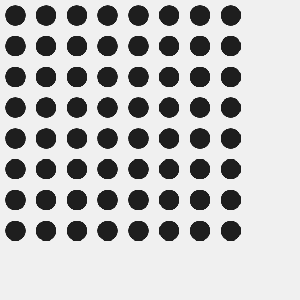
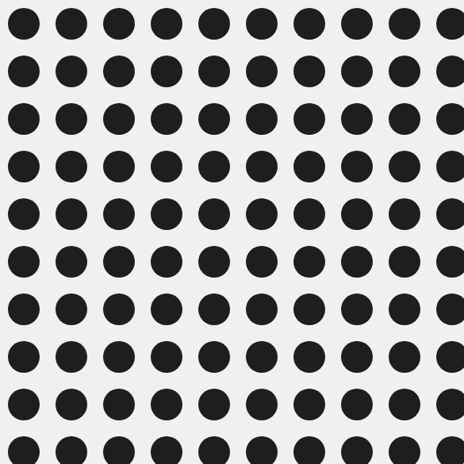
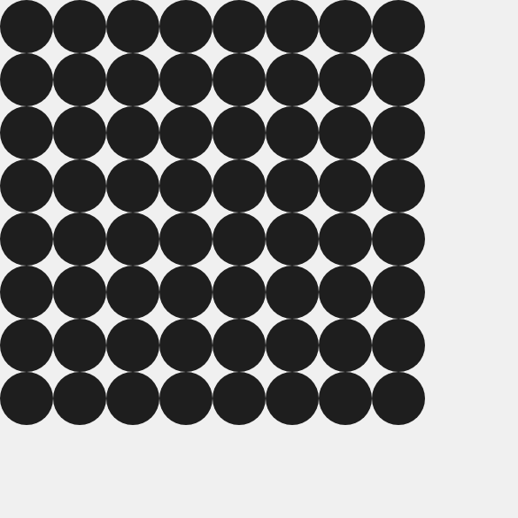
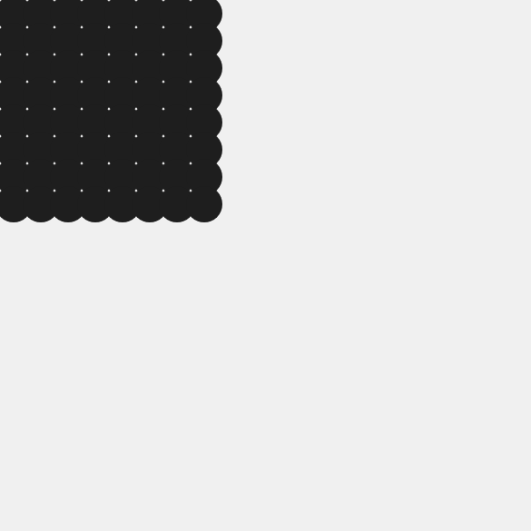

# L01 · Griglia di cerchi

Il primo codice del corso. Disegna una griglia di cerchi. In cima ci sono tre [variabili](../../04_Glossario/Variabile.md) con nomi parlanti: per ora si cambiano solo quelle.

- Lo sketch nell'editor online di p5.js: https://editor.p5js.org/valentina.rachiele/sketches/VDE7UPO1g (link breve: https://shorturl.at/jARZ5)
- Lo sketch: [sketch.js](sketch.js)
- La pagina per aprirlo fuori dall'editor online: [index.html](index.html)

```js
let colonne = 8;     // quanti cerchi in ogni riga (e quante righe)
let diametro = 40;   // quanto è grande ogni cerchio, in pixel
let distanza = 60;   // quanto spazio c'è tra il centro di un cerchio e il successivo, in pixel
```

## Provate a prevedere

Prima di cambiare un numero, dite ad alta voce che cosa succederà. Poi provate.

| Che cosa cambiate | Che cosa succede |
|---|---|
| niente: `colonne = 8`, `diametro = 40`, `distanza = 60` |  |
| `colonne = 20` |  |
| `diametro = 60` |  |
| `distanza = 30` |  |

## Che cosa contiene, riga per riga

- `let colonne = 8;` crea una variabile: un nome che contiene un valore. `let` vuol dire "sia"
- `function setup()` contiene le istruzioni che p5.js esegue una volta sola, all'avvio
- `createCanvas(600, 600)` crea il foglio su cui si disegna, di 600 × 600 pixel
- `background(240)` colora il foglio. Un numero solo vuol dire un grigio: 0 è nero, 255 è bianco
- `noStroke()` toglie il contorno alle forme, `fill(30)` sceglie il colore di riempimento
- i due `for`, uno dentro l'altro, ripetono il disegno: per ogni riga, tutte le colonne. Li vedremo bene nelle prossime lezioni
- `circle(x, y, diametro)` disegna un cerchio con il centro nel punto `x, y`

## Errori tipici

- **Cancellare il punto e virgola** in fondo alla riga. In questo sketch di solito non succede niente, ma è meglio lasciarlo sempre
- **Scrivere un numero con la virgola**, come `40,5`. In JavaScript i decimali si scrivono con il punto: `40.5`
- **Cambiare il nome della variabile** solo in cima. Il nome compare anche più sotto: se lo cambiate in un punto solo, il programma si ferma con un errore
